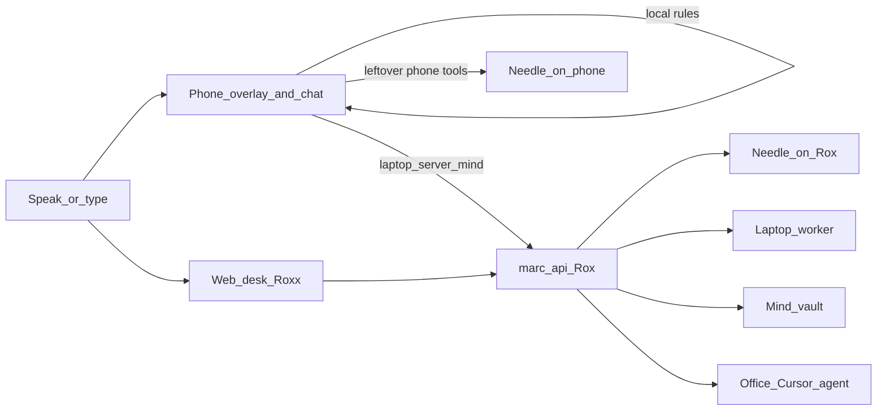

# Marc — Product Requirements Document

**Product:** Marc (desk branded **Roxx**)
**Owner / only user:** Ranjith
**Status:** Live personal system (not a public product)
**Out of scope:** TV Lock, any TV / YouTube parental remote, and any IR or device remote-controller. Those are a separate product.

This document describes the assistant as it actually runs: home-server coordinator, on-device phone planner, web desk, laptop worker, mind vault, and Office coding agent. It is not the older laptop-only “hey Jarvis” brief in [marc_project_brief.md](marc_project_brief.md).

---

## 1. Problem

Ranjith needs one assistant that:

- Hears or reads a short command
- Decides **which machine** should act (phone, laptop, home server)
- **Does the thing**, then speaks a one-line result
- Remembers where work left off without being asked to recap

He should not open Settings, ADB, SSH, or a chat model UI for everyday actions.

---

## 2. Product vision

Marc is a **personal action assistant**, not a chatbot.

- Typed or spoken input becomes **tools**, not essays
- Fast phrases skip models
- Hermes (agent on Rox) plans leftover commands; Meta AI and Needle are LLMs it may use
- Phone still runs on-device Needle as a local LLM for leftover phone-only tools
- Qwen 0.5B stays installed; default planner is Hermes (`MARC_PLANNER=hermes`; rollback `needle` / `qwen`)
- Memory is an Obsidian mind vault plus a Cognee brain on the home server

**North star:** Say it once. The right device does it. Marc still knows what you were doing tomorrow.

---

## 3. Users and devices

| Role | Device | Role in the product |
|------|--------|---------------------|
| Ranjith | Nothing Phone (3a) Lite | Primary mouth and hands: camera-cutout overlay, Chat, queued phone tools |
| Ranjith | Windows laptop | Hands for apps, mail, search, YouTube, typing |
| Home Linux host **Rox** | Always-on coordinator | `marc-api`, Needle, mind vault, desk, Office agent, Ollama (unused for planning) |

Single-user. Bearer token (`MARC_TOKEN`) on every coordinator call. No accounts, no multi-tenant, no manufacturing/cloud product stack.

---

## 4. Goals

1. **Act locally first.** Open, type, YouTube, Google, Spotify, WhatsApp on the phone without waiting for Rox.
2. **Plan leftovers with Hermes.** Meta AI primary; Needle LLM and heuristics as fallback. Empty plans do not invent tools.
3. **Reach the other machines.** Laptop tools via the Windows worker (including agent-desktop); server status/restarts via Rox.
4. **Remember.** “What was I doing” (mind vault), deeper “what do you know” (Cognee), daily notes, desk chat restore.
5. **Office.** A Cursor agent against `/home/rox/office/work` from desk or phone.
6. **Stay small and private.** Overlay size unchanged. No board-name copy in the phone UI. Secrets never committed.

---

## 5. Non-goals

- TV Lock, YouTube-on-TV lock, PIN parental remote, extra tablet apps
- Public SaaS, teams, billing
- Free-text chat as the main product (Needle does not chat; empty calls refuse)
- Reboot, shutdown, `sudo`, `rm -rf /`
- Replacing the overlay with a full launcher
- Fine-tuning Needle in v1 of this PRD (base Needle 3 + a small phone/server toolset)

---

## 6. Product surfaces

### 6.1 Phone overlay (live app 2.34+)

- Pill locked to the front-camera cutout (width/height unchanged from the 2.17 rollback)
- Tap: listen. Long-press: Chat
- Spoken line + optional Yes/No confirm chips
- After an APK update, pill still shows via `TYPE_APPLICATION_OVERLAY` if accessibility was reset; camera-hole taps work fully when Marc is on in Settings → Accessibility
- On-device Needle (`libneedle_cli.so` + `needle3.cact`, loopback `:18096`) warms with the overlay service
- Routing order: PhoneControls → LocalMarc (including open/type/YouTube/Google) → Needle on phone → `POST /utterance` on Rox
- Laptop/server named phrases skip local Needle and go to Rox

### 6.2 Phone Chat

- Same token, `session_id=phone`, target Auto / Phone / Laptop / Server
- Action-like text goes through the overlay service; small talk hits `/chat`
- Office tab: continue / new / stop against the Office agent

### 6.3 Web desk (Roxx)

Private Tailscale site. Pages: Chat, Office, Agent, Mind, Laptop, Phone, Server, Disks, System, Settings. Analog status rings. Presence. Chat restore from the mind vault.

### 6.4 Laptop worker

No model. Executes allowlisted Windows tools when `MARC_LAPTOP_URL` is set. If the worker is down, Marc says the laptop is not connected instead of hanging.

---

## 7. Core user loop

1. User speaks or types a short command.
2. **Target:** Auto (session default), or Phone / Laptop / Server. Phrases `on my phone` / `on my laptop` / `on the server` override.
3. **Instant:** hi, time, date, remember/forget, who am I, what was I doing, what’s my IP.
4. **Hard refuse:** reboot, shutdown, `rm -rf /`.
5. **Direct:** single open/close; server status/restart/docker.
6. **Scripted phone:** `open X type Y send it`, `search youtube for …`, `open Google and search for …`.
7. **Needle:** leftover tool calls. Act at confidence ≥ 0.45. Do not run `suppressed_calls`.
8. Execute on the named device. Speak one short line.

Confirm prompts exist for mail compose/send, dial, and food search (`CONFIRM_TOOLS`). Everyday open/play/type does not confirm.

---

## 8. Feature requirements by device

### 8.1 Phone (must)

| Action | Behavior |
|--------|----------|
| Open / close app | Match launcher label; Spotify pause on close |
| Type into focused field | `type_into`; `send` true on “enter” / “send it” |
| Spotify | `play_music` query or media keys |
| YouTube / Google search | Open that app, type query, submit |
| WhatsApp / SMS / Instagram | Prefill; send only if the user said send |
| Call | Dial contact or number |
| Food | Swiggy / Zomato search |
| Camera | Open or take photo / selfie |
| Follow-ups | next / pause / resume on the app already open |

### 8.2 Laptop (must when worker is up)

Open/close/focus apps, Google/web/YouTube search, play nth result, type, hotkeys, volume, Gmail search/summarize/compose/send, calendar list/create, Drive search, open URL, system status.

### 8.3 Home server (must)

| Tool | Allowlist |
|------|-----------|
| `server_status` | CPU, temp, RAM, service health |
| `service_status` / `service_restart` | api, desk, bridge, ollama, n8n |
| `docker_list` / `docker_restart` | n8n only |
| `server_shell` | User `rox`, cwd `/home/rox/marc`, 15s, deny reboot/shutdown/sudo/delete-root |

---

## 9. Mind (brain)

Vault at `/home/rox/marc/mind` (Obsidian-compatible):

- `NOW.md` — current focus, last actions, open loops, Office
- `daily/YYYY-MM-DD.md` — append-only day log
- `projects/`, `people/`, `chat/` — durable notes and desk/phone transcripts

**Spoken:** “what was I doing”, “remember …”, “forget …”, “who am I”.
**Needle tools on Rox:** `mind_now`, `mind_note`, `mind_recall`.
Every utterance and Office hop also writes the vault so the next “where did we leave off” is current.

---

## 10. Office

- Agent: Cursor `composer-2.5` via `marc-cursor` on loopback `:8093`
- Work dir: `/home/rox/office/work` (optional SSH mount)
- Desk and phone: New task / Continue / Stop
- Summaries land in the mind vault
- Not a general remote desktop

---

## 11. Planning stack

| Layer | Job |
|-------|-----|
| Regex / LocalMarc | Obvious commands, zero model |
| Needle on phone | Local LLM for leftover phone tools (~35 MB), burst CPU |
| Hermes on Rox (`marc-muse` `:8096`) | Controlling agent for leftovers; Meta AI + optional Needle LLM |
| Needle on Rox `:8094` | Local LLM fallback when Hermes/Meta miss |
| Cognee | Graph brain beside mind vault (`brain_recall`) |
| agent-desktop | Laptop GUI observe/act/verify via accessibility refs |
| Laya / Qwen | Idle while `MARC_PLANNER=hermes` (rollback `needle` / `qwen`) |

Hermes emits `{reply, steps}` only. `gate_steps` / `exec_step` still execute. See [hermes_cognee.md](hermes_cognee.md).

---

## 12. Safety and privacy

- Bearer token on coordinator APIs
- Desk is private (Tailscale); do not publish the long desk path
- Overlay/chat never print `MARC_TOKEN`, SSH password, blob/OIDC tokens
- Phone UI: no board name, no “active”
- Confirm before mail send/compose, dial, food order search
- Needle guesses below 0.45 are dropped; heuristics may still run a clear phrase

---

## 13. UX constraints (phone)

- Overlay geometry frozen (2.17 rollback size)
- Short spoken replies (“Opening Terminal.”, “Playing despacito.”)
- Failures: “Laptop isn't connected.”, “Needle is still thinking.”, “Needle isn't running.” — only when that is actually true
- After APK install, pill must still appear without waiting for Accessibility to be toggled again

---

## 14. Success criteria

- Phone command that names an installed app opens it in one turn
- “Open terminal type ipconfig and send it” types on the phone, not SMS, not the laptop
- “Search YouTube for rain sounds” does not start Spotify
- “What’s IP address” speaks Rox addresses
- “Check the server” returns CPU / temp / RAM / service health
- “What was I doing” reflects the last real turn
- Overlay still visible after an APK update
- Needle leftover on a healthy phone finishes in a few seconds without a large battery drain (inference is burst-only)

---

## 15. System inventory (live)

| Process | Port / place |
|---------|----------------|
| `marc-api` | `:8090` |
| `marc-desk` | `:8095` |
| `marc-cursor` | `:8093` loopback |
| `marc-muse` / Hermes | `:8096` loopback |
| `marc-needle` | `:8094` loopback (LLM) |
| Phone Needle | `:18096` loopback |
| Cognee data | `/home/rox/cognee/data` |
| Laya | `:8091` (idle while Hermes is planner) |
| Ollama Qwen | present, not planning |

Sources of truth: `_island/marc_api.py`, `_island/hermes_client.py`, `_island/muse_client.py`, `_island/cognee_bridge.py`, `_island/desk.html`, `_island/NeedleEngine.java`, `_island/LocalMarc.java`, `_island/mind_store.py`, `_island/marc_cursor.py`.
